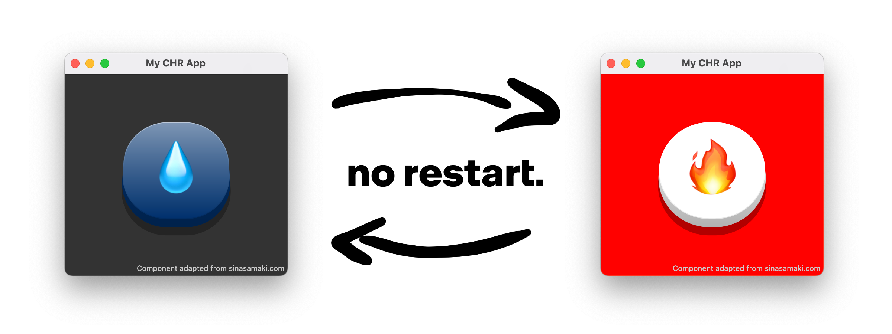
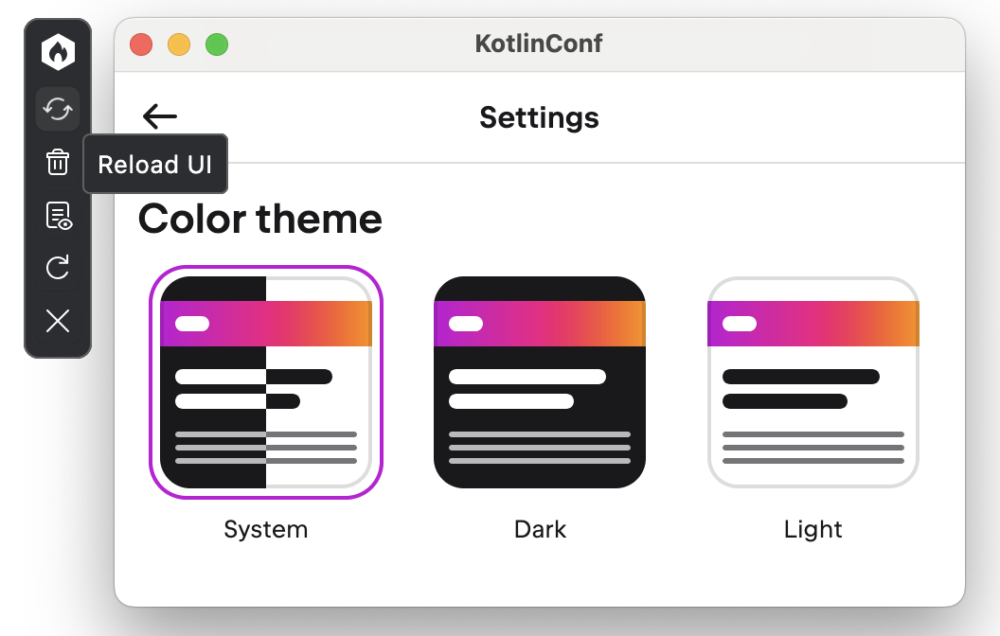

#  Compose Hot Reload

[](https://confluence.jetbrains.com/display/ALL/JetBrains+on+GitHub)
[](https://kotlinlang.org/docs/components-stability.html)
[](https://search.maven.org/artifact/org.jetbrains.compose.hot-reload/hot-reload-core)
[](LICENSE.txt)
[](https://www.jetbrains.com/help/kotlin-multiplatform-dev/compose-hot-reload.html)
[](https://kotlinlang.slack.com/messages/compose-desktop/)

Build Compose UIs faster and let your creativity flow when designing multiplatform user interfaces.

<picture>
  <source media="(prefers-color-scheme: dark)" srcset="./readme-assets/banner_dark.png">
  
</picture>

With Compose Hot Reload, you can make UI code changes in a Compose Multiplatform app and see the results instantly,
without needing to restart.
The JetBrains Runtime intelligently reloads your code whenever it changes.

> [!IMPORTANT]  
> Compose Hot Reload needs a JVM or Android target in your multiplatform project.
> The Android target is new and experimental: see [Hot reload on Android](#hot-reload-on-android).

## Prerequisites

Ensure that your project meets the minimum version requirements:

- Kotlin 2.1.20 or higher.
- Compose compiler 2.1.20 or higher.
- Compose Multiplatform 1.8.2 or higher.
  * CHR `1.2.0-alpha02` and later requires Compose Multiplatform `1.10.0+`.
- For the JVM target: [JetBrains Runtime](https://github.com/JetBrains/JetBrainsRuntime).
  To be compatible with JetBrains Runtime, your project must
  [target](https://docs.gradle.org/current/userguide/building_java_projects.html#sec:java_cross_compilation)
  Java 21 or earlier.
- For the Android target: the Android Gradle Plugin (Compose Hot Reload is tested with AGP `8.11` and
  `9.1`) and a device or emulator running Android 9 Pie (API level 28) or later.

For the best development experience, we recommend using an IDE with the Kotlin Multiplatform plugin:

- IntelliJ IDEA 2025.2.2 or higher, or Android Studio Otter 2025.2.1 or higher.
- [Kotlin Multiplatform IDE plugin](https://plugins.jetbrains.com/plugin/14936-kotlin-multiplatform).

## Set up your project

There are two ways to add Compose Hot Reload to your project:

* [Create a project from scratch in IntelliJ IDEA or Android Studio](#create-a-project-from-scratch)
* [Add it as a Gradle plugin to an existing project](#apply-the-gradle-plugin-to-your-project)

### Create a project from scratch

Follow the [Kotlin Multiplatform quickstart](https://www.jetbrains.com/help/kotlin-multiplatform-dev/quickstart.html)
guide to set up your environment and create a project. Be sure to select at least one supported application target: desktop (JVM) or Android.

### Apply the Gradle plugin to your project

1. In your project, update the version catalog. In `gradle/libs.versions.toml`, add the following code:

   ```
   composeHotReload = { id = "org.jetbrains.compose.hot-reload", version.ref = "composeHotReload"}
   ```

2. In the `build.gradle.kts` of your parent project, add the following code to your `plugins {}` block:

   ```
   plugins {
       alias(libs.plugins.composeHotReload) apply false
   }
   ```

   This prevents the Compose Hot Reload plugin from being loaded multiple times in each of your subprojects.

3. In the `build.gradle.kts` of the subproject containing your multiplatform application, add the following code to your
   `plugins {}` block:

   ```
   plugins { 
       alias(libs.plugins.composeHotReload)
   }
   ```

4. For a JVM target, you need an installation of the JetBrains Runtime:
   Launching Compose Hot Reload with the Kotlin Multiplatform IDE plugin will re-use IntelliJ's installation of the
   JetBrains Runtime.
   If you want Gradle to automatically download the JetBrains Runtime, add the following code to your
   `settings.gradle.kts` file
   ```
   plugins {
       id("org.gradle.toolchains.foojay-resolver-convention") version "1.0.0"
   }
   ```
    Alternatively, you can use automatic JetBrains Runtime provisioning for the hot reload tasks by enabling
    the `compose.reload.jbr.autoProvisioningEnabled` property.

> [!IMPORTANT]  
> Automatic JetBrains Runtime provisioning is an experimental feature. Please report any issues you encounter.

5. Click the **Sync Gradle Changes** button to synchronize Gradle files:

    

## Use Compose Hot Reload

You can run your application with Compose Hot Reload using your IDE or the CLI via Gradle tasks.
Compose Hot Reload supports two modes: **Explicit** mode and **Auto** mode.

* In **Explicit** mode, you manually trigger the reload to apply changes.
* In **Auto** mode, Compose Hot Reload uses Gradle’s file-watching and continuous build system
to automatically reload when file changes are detected.
To enable this mode, specify the `--autoReload` or `--auto` arguments in CLI 
or in the run configuration settings.

### In the IDE

In IntelliJ IDEA or Android Studio, you can run Compose Hot Reload directly from the IDE gutter.

1. Click the **Run** icon  
in the gutter of your main function and select **Run 'shared [jvm]' with Compose Hot Reload**.

2. When you save code changes, the reload is triggered automatically. 

   Alternatively, you can trigger the reload explicitly by pressing the assigned shortcut key or
   clicking the **Reload UI** button:

    

You can modify the trigger behavior on the **Settings | Tools | Compose Hot Reload** page in your IDE.

> [!IMPORTANT]  
> If you don't have the [Kotlin Multiplatform IDE plugin](https://plugins.jetbrains.com/plugin/14936-kotlin-multiplatform)
> installed, you can manually create Gradle run configurations with hot reload tasks (see [Run tasks](#run-tasks)).
> In this case, you can trigger the reload by clicking the **Reload UI** button or running the `reload` Gradle task.

### From the CLI

#### Run tasks

The Compose Hot Reload plugin automatically creates the following tasks to launch the application:

- `:hotRunJvm`: For multiplatform projects. The async alternative is `:hotRunJvmAsync`.
- `:hotRun`: For Kotlin/JVM projects. The async alternative is `:hotRunAsync`.
- `:hotRunAndroid`: For Android application modules using `androidTarget()`. When the Android
  application module is a pure Android module — e.g. the `androidApp` module of the common `androidApp` + `shared` project structure —
  the task is `:hotRun`. See [Hot reload on Android](#hot-reload-on-android).

You can run these Gradle tasks from the command line:

```shell
./gradlew :app:hotRunJvm
# or
./gradlew :composeApp:hotRunJvm
```

After making changes, save all files to automatically update your app's UI.

##### Custom target name

If you define a custom JVM target name, Gradle uses a different task name. For example, if your target name is
`desktop`:

```kotlin
kotlin {
    jvm("desktop")
}
```

The task name is `:hotRunDesktop`.

##### Command-line arguments

Here's a list of all the possible arguments that you can use with the Gradle run tasks:

| Argument                           | Description                                   | Example                                                                         |
|------------------------------------|-----------------------------------------------|---------------------------------------------------------------------------------|
| `--mainClass <Main class FQN>`     | The main class to run.                        | `./gradlew :app:hotRunJvm --mainClass com.example.MainKt`                       |
| `--autoReload` <br> `--auto`       | Enable automatic reloading. Default: `false`. | `./gradlew :app:hotRunJvm --autoReload` <br> `./gradlew :app:hotRunJvm --auto`  |
| `--no-autoReload` <br> `--no-auto` | Disable automatic reloading.                  | `./gradlew :myApp:hotRunJvm --no-auto` <br> `./gradlew :myApp:hotRunJvm --auto` |

##### Configure the main class

You can configure the main class directly in your build script instead of passing it as a command-line argument.

You can configure it in the Compose Hot Reload task:

```kotlin
tasks.withType<ComposeHotRun>().configureEach {
    mainClass.set("com.example.MainKt")
}
```

Or if you use Compose Multiplatform, in the `application {}` block:

```kotlin
compose.desktop {
    application {
        mainClass = "com.example.MainKt"
    }
}
```

#### Reload tasks (Explicit mode)

> [!WARNING]  
> You can't run reload tasks with the `--autoReload` or `--auto` command-line argument.

The Compose Hot Reload plugin also provides Gradle tasks to recompile **and** reload your application:

- `reload`: Reload all, currently running, applications.
- `hotReloadJvmMain`: Reload all applications that use the `jvmMain` source set.
- `hotReloadAndroid`: Reload all running Android applications whose application module uses
  `androidTarget()`. When the Android application module is a pure Android module, the task is
  `hotReload`.

For example:

```shell
./gradlew :app:reload
```

## Hot reload on Android

*Note: the Android target is in experimental status.*

Applying the Gradle plugin is all the setup the Android target needs: in Android modules the plugin
creates a dedicated **`composeHotReload` build type**. This build type is debuggable and signed with
the debug signing config — so the app can be installed and its classes redefined on the device — and
the hot reload runtime is added to it only. Your `debug` and `release` variants are not affected.
The `composeHotReload` variant installs under your application id, replacing the previously
installed build.

The hot variant requires a device or emulator running **Android 9 Pie (API level 28) or later**:
the runtime relies on JVMTI, which Android provides from API 28. If your project's `minSdk` is
lower, the hot variant's `minSdk` is raised to 28 automatically; other variants keep your `minSdk`.
Compose Hot Reload works with `kotlin("multiplatform")`, with
`org.jetbrains.kotlin.android`, and with AGP 9's built-in Kotlin support.

### Run the app

```shell
./gradlew :app:hotRunAndroid  # a KMP application module using 'androidTarget()'
./gradlew :androidApp:hotRun  # a pure Android application module, e.g. 'androidApp' + 'shared'
```

The task name follows the Android application module's Kotlin setup: it is `hotRunAndroid` when
that module uses `androidTarget()`, and `hotRun` when it is a pure Android module
(`org.jetbrains.kotlin.android` or AGP 9's built-in Kotlin) — like the `androidApp` module of the
common Kotlin Multiplatform project structure, where the shared code lives in a `shared` module.
The hot reload tasks live in the application module and reload changes in the modules it depends
on (such as `shared`) as well; external dependencies are never reloaded. Run and reload from the
application module, e.g. `./gradlew :androidApp:hotRun` and `./gradlew :androidApp:reload`.

With product flavors, the flavor name is appended to the task, e.g. `:app:hotRunAndroidFree`.

The task builds and installs the APK, launches the app on the device in hot reload mode, and keeps
the session running until you interrupt it (Ctrl-C also stops the app on the device).

If exactly one device or emulator is attached, it is picked automatically. When several are
attached, select one with `-Pchr.android.serial=<serial>` (or the `ANDROID_SERIAL` environment
variable).

The [counter sample](samples/counter) in this repository includes an Android target you can try
this with.

### Reload code

Edit your code and run:

```shell
./gradlew :app:reload # a KMP application module
./gradlew :androidApp:reload  # a pure Android application module
```

The task recompiles the changed sources and hot-reloads them into the running application without
restarting it. The same `reload` task ships changes to every running target, so desktop and Android
applications can be reloaded together.

The application's hot reload logs are available via `adb logcat -s ComposeHotReload`.

### Current limitations

- **Method-body changes only.** The Android runtime can only redefine the bodies of existing
  methods. Structural changes — adding or removing methods or fields, changing signatures or class
  hierarchies — cannot be hot-reloaded; restart the app to pick them up.
- **No new classes.** Edits that add a class are rejected with an error — including edits that only
  introduce a new lambda, which compiles to a new class. Revert the change or restart the app.
- **`remember` state resets.** Every Android reload rebuilds the whole composition, so state held
  in `remember { … }` is lost; state held outside the composition (e.g. in `ViewModel`s or
  singletons) survives. Use the [runtime API](docs/Known_limitations.md) hooks to reset or restore
  state explicitly after a reload.
- **Explicit reload mode only.** The `--auto`/`--autoReload` arguments, the DevTools window, and
  the MCP server apply to the desktop (JVM) target only. Reload Android apps with the `reload`
  Gradle task.
- **Compose Multiplatform resources are not reloaded.** Changes to resources in
  `composeResources` (strings, images, fonts, …) are not picked up; restart the app to see them.
- **No reload effects.** The visual reload effects available on the desktop target are not shown
  on Android.
- **Core library desugaring is not supported** in the hot variant: the reload fails with an
  explicit error when `isCoreLibraryDesugaringEnabled` is enabled.

We plan to remove these limitations in future releases.

### Compose Hot Reload and Android Studio Live Edit

[Live Edit](https://developer.android.com/develop/ui/compose/tooling/iterative-development#live-edit)
is Android Studio's feature for updating composables on a running Android device. Both tools
apply code changes to a running app without restarting it, and the ART runtime sets the same
basic limit for both on Android: method bodies can be changed, class structure can't.

> [!TIP]
> **The key difference for Kotlin Multiplatform projects:** Compose Hot Reload applies changes made
> in the **common source set** (e.g. `commonMain`) as well as in Android-specific ones, while Live
> Edit supports only changes in **Android source sets**. If your UI lives in shared code, Live Edit
> can't reload it.

The tools also differ in how they are used:

|                       | Compose Hot Reload (Android target)                                  | Live Edit                                    |
|-----------------------|----------------------------------------------------------------------|----------------------------------------------|
| Where it runs         | Gradle tasks: from the command line, any IDE, or an AI agent         | Android Studio                               |
| How code is compiled  | Your regular Gradle build                                            | Android Studio compiles the changed code     |
| Triggering a reload   | Explicit: the `reload` Gradle task                                   | Automatically while editing, or manually     |
| Source sets           | Common and Android source sets                                       | Android source sets only                     |
| Supported changes     | Method bodies; no structural changes, no new classes                 | Method bodies; no structural changes         |
| Minimum device API    | 28                                                                   | 30                                           |
| Other targets         | The same plugin hot-reloads the desktop target, including structural changes | Android only                         |

The Live Edit column reflects its documentation at the time of writing; check the link above for
the current state.

## Use developer builds

If you want to try the latest changes in Compose Hot Reload, you can use `dev` builds. To use the latest 'dev' builds of
Compose Hot Reload, add the `firework` Maven repository in your `settings.gradle.kts` file:

```kotlin
pluginManagement {
    repositories {
        maven("https://packages.jetbrains.team/maven/p/firework/dev")
    }
}

dependencyResolutionManagement {
    repositories {
        maven("https://packages.jetbrains.team/maven/p/firework/dev")
    }
}
```

## MCP server for AI agents

*Note: the MCP server is in experimental status and available since the 1.2.0-alpha01 version of Compose Hot Reload.*

Compose Hot Reload includes a [Model Context Protocol (MCP)](https://modelcontextprotocol.io/) server that allows
AI agents to interact with a running Compose application. The MCP server connects to the application's orchestration
layer and exposes the following tools:

| Tool | Description                                                 |
|------|-------------------------------------------------------------|
| `status` | Checks whether a Compose application is currently connected. When connected, also reports the build mode (`buildContinuous`: `true` for `--auto`, `false` for explicit), reload state, last error (with optional `lastErrorDetails`), counts of successful/failed reloads, and any windows currently failing to render (`uiErrorWindows`). Use `buildContinuous` to choose between `reload` and `await_reload` |
| `reload` | Recompiles the project and hot-reloads the changed classes into the running application. Reports whether classes were reloaded, or `{"status": "reloading"}` when it does not finish within the optional `timeout_seconds` (default 60) — in that case, poll `status` until `reloadState` is no longer `reloading` |
| `await_reload` | Waits for an autonomous hot reload when the application was started with continuous build mode (`--auto`). Returns `{"success": true}` once the application is in a healthy reloaded state, or `{"status": "reloading"}` when the reload does not finish within the optional `timeout_seconds` (default 60) — in that case, poll `status` until `reloadState` is no longer `reloading` |
| `list_windows` | Lists registered application windows as a JSON array (`id`, `title`, `x`, `y`, `width`, `height`) |
| `get_ui_error` | Returns the runtime UI exception currently thrown while a window renders its UI (e.g. an exception in a `@Composable`). Reports `hasError`, and when true, the `message` and `stacktrace` lines |
| `get_logs` | Returns the most recent log lines from the running Compose application as plain text (oldest first). The `limit` parameter caps the number of lines (default 200; 0 returns all) |
| `take_screenshot` | Captures a screenshot of the application window |
| `get_semantic_tree` | Returns the Compose semantic/accessibility tree of the application as JSON (component roles, names, descriptions, states, and bounds) |
| `click` | Clicks the UI element with the given `nodeId`. The node must expose `onClick` in `get_semantic_tree` |
| `long_click` | Long-presses the UI element with the given `nodeId`. The node must expose `onLongClick` |
| `type_text` | Replaces the content of an editable text field (`nodeId`) with the given `text`. The node must expose `editableText` |
| `scroll` | Scrolls a scrollable container (`nodeId`) by `deltaX` / `deltaY` logical pixels. The node must support the `ScrollBy` semantic action |
| `scroll_to_index` | Scrolls a container (e.g. `LazyColumn` / `LazyRow`, `nodeId`) so the item at zero-based `index` becomes visible. The node must support the `ScrollToIndex` semantic action |
| `resize_window` | Resizes the window to the given `width` × `height` in pixels (both must be positive) |
| `restart` | Restarts the running Compose application. Waits for the new process to reconnect, or returns `{"reconnected": false}` when it does not finish within `timeout_seconds` (default 60) — in that case, poll `status` until `connected` is true |
| `reset_ui` | Discards the current composition so all `remember`-ed state is dropped and the UI rebuilds from scratch |

#### Targeting a specific window

The following tools accept an optional `window_id` parameter: `take_screenshot`, `get_semantic_tree`, `click`, 
`long_click`, `type_text`, `scroll`, `scroll_to_index`, `resize_window`, and `get_ui_error`.
All window-targeting tools follow the same window-selection rules. An agent may use `list_windows` to discover the available IDs.

- **`window_id` provided** — the tool operates on that specific window.
- **`window_id` omitted** — the tool operates on the *first registered window*, that is, the first window
  the running application has added to its window state. Concretely, this is the first window that is
  composed and shown during startup (the first `Window { ... }`, `singleWindowApplication { ... }`,
  or `DialogWindow { ... }` reached). Windows opened later in the session are appended in registration
  order; closing a window removes it from that list, so the "first registered" entry can change at
  runtime if the original first window is closed.
- **`window_id` does not match any currently registered window** — the tool returns
  `Window '<id>' not found`.

When the MCP server starts, it waits for the app to launch, detects shutdown, and
reconnects automatically on restart.

### The MCP server Gradle task

Compose Hot Reload exposes the MCP server through a Gradle task:

```shell
./gradlew :app:hotMcpServerJvm
# or
./gradlew :composeApp:hotMcpServerJvm
```

The task name follows the same naming convention as the run tasks. For a custom JVM target named `desktop`,
the task would be `:app:hotMcpServerDesktop`.

Note: you don't need to run this task yourself — your AI agent launches the server for you once you point it to
this task (see below). The server does not require a running application: it starts, waits for the app to
launch, and then connects automatically. Running the task manually is only useful if you want to start or
inspect the server on your own.

### Configure an AI agent

To connect an AI agent, point its MCP client configuration to the Gradle task shown above. The agent then
starts and stops the server on its own — there is no need to launch it manually. For example, in a `.mcp.json`:

```json
{
  "mcpServers": {
    "compose-hot-reload": {
      "command": "./gradlew",
      "args": [
        "--no-daemon",
        "--quiet",
        "--console=plain",
        "hotMcpServer"
      ]
    }
  }
}
```

Note: the short, unqualified `hotMcpServer` task name is enough here — you don't need the project path or JVM
target suffix from the previous example. Gradle resolves an unqualified name against the current project and
all its subprojects, so it finds the task wherever it is defined. Gradle's camelCase task-name abbreviation also
matches `hotMcpServer` against the target-specific task (`hotMcpServerJvm`, `hotMcpServerDesktop`, …). In a
plain Kotlin/JVM module the task is simply named `hotMcpServer`. If a module declares more than one JVM
target, the short name becomes ambiguous — use the explicit `:<module>:hotMcpServer<Target>` form instead.

## FAQ

### I'm developing an Android-only app without Kotlin Multiplatform. Can I use Compose Hot Reload?

Yes, with the experimental Android target. Add the Compose Hot Reload plugin to your Android
application module:

```kotlin
plugins {
    ...
    id("org.jetbrains.compose.hot-reload")
}
```

The Compose Multiplatform Gradle plugin must also be available in the build — Kotlin Multiplatform
projects include it anyway (e.g. declared in the root build script with `apply false`); a plain
Android-only project should add it too:

```kotlin
plugins {
    ...
    id("org.jetbrains.compose")
}
```

Then run the app with the `:hotRun` task (see [Hot reload on Android](#hot-reload-on-android)).

Keep in mind that the Android target is a work in progress. It lacks many features of the
desktop target, most notably structural changes (adding methods, fields, or classes) — see the
[current limitations](#current-limitations). If you need those features, you can convert your
project to Kotlin Multiplatform (if it isn't already), add a desktop (JVM) target, and use Compose
Hot Reload on the desktop following
[the instructions](#apply-the-gradle-plugin-to-your-project).

### My project is a desktop-only app with Compose Multiplatform. Can I use Compose Hot Reload?

Yes! However, be aware that you can't start the application via the run button in the
gutter ([CMP-3123](https://youtrack.jetbrains.com/issue/CMP-3123)). Instead, use [Gradle tasks](#from-the-cli).

## Feedback and issues

Feel free to submit any feedback to the [CMP issue tracker](https://youtrack.jetbrains.com/newIssue?project=CMP&c=Library%20group%20Hot%20Reload). If you encounter an issue, please check the 
[known issues and limitations](docs/Known_limitations.md) for potential workarounds. 
